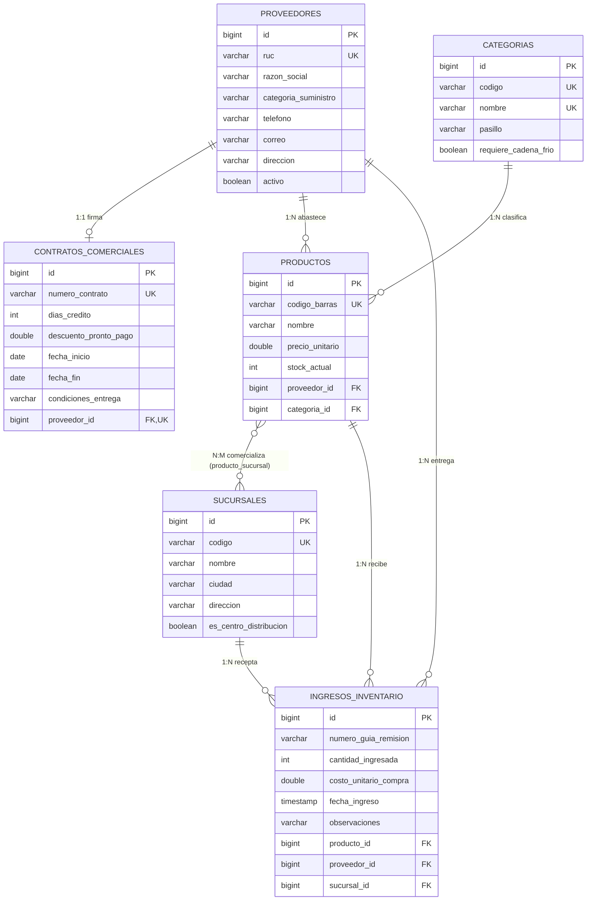

# Documentación Técnica: Diseño ORM con JPA/Hibernate y Consultas JPQL — Caso de Estudio Supermaxi

## 1. Descripción del Caso de Estudio y Alcance Funcional

El sistema modela la gestión de abastecimiento, catálogo de productos y recepción de mercadería en bodega para **Supermaxi**. Se ha implementado bajo una arquitectura **MVC + DAO** en Java 17 con **Jakarta Persistence API (JPA 3.1)** y **Hibernate ORM 6.4.4.Final**, integrando una interfaz gráfica Swing multi-pestaña y una suite de pruebas automatizadas con **JUnit 5**.

### Módulos Funcionales Implementados
- **CRUD Completo de Proveedores (+ Contrato Comercial 1:1):** Creación, consulta paginada y búsqueda por RUC, actualización de datos y contrato, desactivación (baja lógica) y eliminación física segura en cascada.
- **Create — Catálogo de Productos:** Registro de nuevos productos asignando su código de barras único, precio unitario, stock inicial, proveedor (`N:1`), categoría (`N:1`) y las sucursales donde se comercializa (`N:M`).
- **Create — Ingreso de Productos al Inventario:** Registro de entregas mediante guía de remisión en una sucursal o centro de distribución receptor, actualizando automáticamente el `stock_actual` del producto dentro de la misma transacción JPA.
- **Consultas JPQL Paginadas y Reportes:** Cuatro consultas JPQL parametrizadas con filtros dinámicos (`WHERE`/`HAVING`), ordenamiento seguro (`ORDER BY`) y paginación en base de datos (`setFirstResult` / `setMaxResults`).

---

## 2. Identificación de Entidades (6 Entidades)

Superando el mínimo requerido de cinco entidades, el dominio se modeló en **6 entidades JPA** ubicadas en el paquete `ec.edu.ups.supermaxi.modelo`:

| # | Entidad JPA | Tabla en BD | Rol en el Dominio Supermaxi | Atributos Principales |
|---|---|---|---|---|
| 1 | `Proveedor` | `proveedores` | Empresa proveedora que abastece mercadería a Supermaxi. | `id`, `ruc` (único, 13 dígitos), `razonSocial`, `categoriaSuministro`, `telefono`, `correo`, `direccion`, `activo` |
| 2 | `ContratoComercial` | `contratos_comerciales` | Acuerdo comercial y condiciones financieras vigentes de cada proveedor. | `id`, `numeroContrato` (único), `diasCredito`, `descuentoProntoPago`, `fechaInicio`, `fechaFin`, `condicionesEntrega` |
| 3 | `Categoria` | `categorias` | Clasificación del catálogo y ubicación física por pasillo/refrigeración. | `id`, `codigo` (único), `nombre` (único), `pasillo`, `requiereCadenaFrio` |
| 4 | `Producto` | `productos` | Artículo comercializado en el catálogo de Supermaxi con control de stock. | `id`, `codigoBarras` (único), `nombre`, `precioUnitario`, `stockActual` |
| 5 | `Sucursal` | `sucursales` | Local Supermaxi o Centro de Distribución donde se vende o recibe mercadería. | `id`, `codigo` (único), `nombre`, `ciudad`, `direccion`, `esCentroDistribucion` |
| 6 | `IngresoInventario` | `ingresos_inventario` | Movimiento histórico de entrada de mercadería a bodega mediante guía de remisión. | `id`, `numeroGuiaRemision`, `cantidadIngresada`, `costoUnitarioCompra`, `fechaIngreso`, `observaciones` |

---

## 3. Modelo Entidad-Relación y Cardinalidades (1:1, 1:N, N:M)



### Detalle de Relaciones Implementadas en JPA

1. **Relación Uno a Uno (`1:1`): `Proveedor` ↔ `ContratoComercial`**
   - **Lado inverso (`Proveedor`)**: `@OneToOne(mappedBy = "proveedor", cascade = CascadeType.ALL, orphanRemoval = true, fetch = FetchType.LAZY)`.
   - **Lado propietario (`ContratoComercial`)**: `@OneToOne(fetch = FetchType.LAZY)` con `@JoinColumn(name = "proveedor_id", nullable = false, unique = true)`.
   - **Decisión de diseño:** La restricción `unique = true` en la clave foránea `proveedor_id` garantiza a nivel de base de datos relacional la cardinalidad estricta `1:1`. El atributo `orphanRemoval = true` y `CascadeType.ALL` aseguran que el ciclo de vida del contrato dependa de su proveedor.

2. **Relaciones Uno a Muchos / Muchos a Uno (`1:N` / `N:1`)**:
   - **`Proveedor` (1) ↔ `Producto` (N):** Un proveedor abastece múltiples productos al catálogo.
   - **`Categoria` (1) ↔ `Producto` (N):** Cada categoría agrupa múltiples productos por pasillo y requerimiento de cadena de frío.
   - **`Proveedor` (1) ↔ `IngresoInventario` (N):** Un proveedor realiza múltiples entregas en bodega.
   - **`Producto` (1) ↔ `IngresoInventario` (N):** Un producto acumula múltiples registros históricos de ingreso al inventario.
   - **`Sucursal` (1) ↔ `IngresoInventario` (N):** Cada sucursal o centro de distribución registra los ingresos físicos recibidos.

3. **Relación Muchos a Muchos (`N:M`): `Producto` ↔ `Sucursal`**
   - **Lado propietario (`Producto`)**: `@ManyToMany(fetch = FetchType.LAZY)` con `@JoinTable(name = "producto_sucursal", joinColumns = @JoinColumn(name = "producto_id"), inverseJoinColumns = @JoinColumn(name = "sucursal_id"))`.
   - **Lado inverso (`Sucursal`)**: `@ManyToMany(mappedBy = "sucursales", fetch = FetchType.LAZY)`.
   - **Decisión de diseño:** Se utilizó `Set<Sucursal>` (`LinkedHashSet`) en lugar de `List` para evitar duplicados y lograr que Hibernate emita sentencias `INSERT`/`DELETE` puntuales sobre la tabla intermedia `producto_sucursal` en vez de eliminar y reinsertar toda la relación al actualizar.

---

## 4. Decisiones de Diseño y Buenas Prácticas Aplicadas

1. **Patrón DAO Genérico Reutilizable (`IGenericDAO` + `AbstractGenericDAO`)**:
   - Se centralizó la gestión de transacciones (`begin`, `commit`, `rollback`), parametrización segura y cálculo de paginación (`PaginaResultado<T>`) en `AbstractGenericDAO`, evitando duplicación de código entre los 6 DAOs.
2. **Actualización Atómica de Stock en `IngresoInventarioDAO.crear`**:
   - Al registrar un `IngresoInventario`, se persiste el comprobante y en la **misma transacción** se incrementa `stockActual` del `Producto` gestionado por el `EntityManager`. Si ocurre un error, el `rollback()` garantiza consistencia entre el historial y el stock.
3. **Estrategia Dual de Eliminación de Proveedores (Baja Lógica vs. Física Segura)**:
   - Se recomienda la **baja lógica** (`activo = false`) para preservar el historial contable de entregas.
   - Para el **borrado físico** (`ProveedorDAO.eliminar`), se eliminan primero los registros dependientes en `IngresoInventario` (tanto por `proveedor.id` como por `producto.proveedor.id`), se sincroniza y limpia el contexto (`em.flush(); em.clear()`), se limpian las asociaciones `N:M` de `producto_sucursal` y finalmente se remueve el `Proveedor`, evitando violaciones de llave foránea (`SQLSTATE 23503` en PostgreSQL).
4. **Prevención del Problema `HHH90003004` y `N+1` en Paginación con Relaciones `N:M`**:
   - En `ProductoDAO.consultarProductosPaginado`, el filtro por sucursal se expresa con una subconsulta `EXISTS (SELECT suc.id FROM prod.sucursales suc WHERE suc.id = :sucursalId)` en lugar de `JOIN FETCH` sobre la colección. De esta forma, `setFirstResult` y `setMaxResults` se traducen a `LIMIT`/`OFFSET` nativo en SQL. Posteriormente se precargan las sucursales de los registros visibles en una sola consulta `WHERE prod IN :productos`.
5. **Construcción Condicional de `WHERE` en JPQL y Lista Blanca de `ORDER BY`**:
   - En PostgreSQL + Hibernate 6, pasar parámetros `null` en predicados `(:param IS NULL OR LOWER(col) LIKE ...)` puede provocar errores de inferencia de tipo (`could not determine data type of parameter` / `lower(bytea)`). Por ello, los filtros opcionales se anexan dinámicamente solo cuando tienen valor.
   - Los campos de ordenamiento (`campoOrden`) se validan mediante mapas estáticos (`CAMPOS_ORDEN`), impidiendo cualquier inyección en la cláusula `ORDER BY`.
6. **Compatibilidad con Esquemas Existentes (`hibernate.hbm2ddl.auto = update`)**:
   - Las nuevas columnas foráneas añadidas sobre tablas ya existentes (`productos.categoria_id` e `ingresos_inventario.sucursal_id`) permiten `NULL` a nivel DDL para evitar errores de migración automática sobre filas previas en PostgreSQL, validándose su obligatoriedad en la capa de controladores (`ProductoControlador` e `IngresoInventarioControlador`).
7. **Unidades de Persistencia Separadas (`SupermaxiPU` y `SupermaxiTestPU`)**:
   - `src/main/resources/META-INF/persistence.xml` mantiene `SupermaxiPU` apuntando a **PostgreSQL** (`supermaxi_db`).
   - `src/test/resources/META-INF/persistence.xml` define `SupermaxiTestPU` sobre **H2 en memoria en modo PostgreSQL** (`MODE=PostgreSQL`), permitiendo ejecutar la suite de pruebas sin requerir un servidor externo (y habilitando la ejecución contra PostgreSQL mediante `-Dsupermaxi.pu=SupermaxiPU`).

---

## 5. Consultas JPQL Implementadas (Filtros, Ordenamiento y Paginación)

Se implementaron **4 consultas JPQL paginadas** (superando el mínimo de 3):

### Consulta 1: Proveedores y Contrato Comercial 1:1 (`ProveedorDAO.consultarProveedoresPaginado`)
- **Propósito:** Filtrar proveedores por estado (`activo`), texto parcial (razón social o RUC), categoría de suministro y días mínimos de crédito del contrato `1:1`.
- **Estructura JPQL:**
  ```jpql
  SELECT p FROM Proveedor p LEFT JOIN FETCH p.contratoComercial c
  WHERE 1=1
    [AND p.activo = :activo]
    [AND (LOWER(p.razonSocial) LIKE LOWER(:texto) OR p.ruc LIKE :texto)]
    [AND LOWER(p.categoriaSuministro) LIKE LOWER(:categoria)]
    [AND c.diasCredito >= :minDias]
  ORDER BY <campoOrdenPermitido> <ASC|DESC>, p.id ASC
  ```
- **Paginación:** `dataQuery.setFirstResult(pagina * tamanioPagina)` y `dataQuery.setMaxResults(tamanioPagina)`, acompañada de consulta `SELECT COUNT(p)`.

### Consulta 2: Catálogo de Productos Multi-Relación (`ProductoDAO.consultarProductosPaginado`)
- **Propósito:** Buscar productos en el catálogo filtrando por texto (nombre o código de barras), categoría (`1:N`), proveedor (`1:N`), sucursal habilitada (`N:M` con `EXISTS`), stock máximo (alerta de reposición) y precio máximo.
- **Estructura JPQL:**
  ```jpql
  SELECT prod FROM Producto prod
  JOIN FETCH prod.proveedor prov
  LEFT JOIN FETCH prod.categoria cat
  WHERE 1=1
    [AND (LOWER(prod.nombre) LIKE LOWER(:texto) OR prod.codigoBarras LIKE :texto)]
    [AND cat.id = :categoriaId]
    [AND prov.id = :proveedorId]
    [AND EXISTS (SELECT suc.id FROM prod.sucursales suc WHERE suc.id = :sucursalId)]
    [AND prod.stockActual <= :stockMax]
    [AND prod.precioUnitario <= :precioMax]
  ORDER BY <campoOrdenPermitido> <ASC|DESC>, prod.id ASC
  ```

### Consulta 3: Historial de Ingresos al Inventario (`IngresoInventarioDAO.consultarIngresosPaginado`)
- **Propósito:** Auditar ingresos en bodega filtrando por proveedor, producto, sucursal receptora, cantidad mínima ingresada, número de guía y rango de fechas.
- **Estructura JPQL:**
  ```jpql
  SELECT i FROM IngresoInventario i
  JOIN FETCH i.producto prod
  JOIN FETCH i.proveedor prov
  LEFT JOIN FETCH i.sucursal suc
  WHERE 1=1
    [AND prov.id = :proveedorId]
    [AND prod.id = :productoId]
    [AND suc.id = :sucursalId]
    [AND i.cantidadIngresada >= :cantidadMin]
    [AND LOWER(i.numeroGuiaRemision) LIKE LOWER(:guia)]
    [AND i.fechaIngreso >= :fechaDesde]
    [AND i.fechaIngreso <= :fechaHasta]
  ORDER BY <campoOrdenPermitido> <ASC|DESC>, i.id DESC
  ```

### Consulta 4: Reporte Agregado de Abastecimiento por Proveedor (`IngresoInventarioDAO.consultarResumenAbastecimiento`)
- **Propósito:** Proyección directa a DTO (`ResumenAbastecimientoDTO`) con `GROUP BY` y `HAVING` para calcular total de entregas, unidades ingresadas e inversión total por proveedor.
- **Estructura JPQL:**
  ```jpql
  SELECT new ec.edu.ups.supermaxi.dto.ResumenAbastecimientoDTO(
      prov.id, prov.ruc, prov.razonSocial, prov.categoriaSuministro,
      COUNT(i.id), COALESCE(SUM(i.cantidadIngresada), 0L),
      COALESCE(SUM(i.cantidadIngresada * i.costoUnitarioCompra), 0.0)
  )
  FROM IngresoInventario i
  JOIN i.proveedor prov
  WHERE 1=1
    [AND prov.activo = :activo]
    [AND i.sucursal.id = :sucursalId]
  GROUP BY prov.id, prov.ruc, prov.razonSocial, prov.categoriaSuministro
  [HAVING COALESCE(SUM(i.cantidadIngresada * i.costoUnitarioCompra), 0.0) >= :inversionMin]
  ORDER BY <campoOrdenPermitido> <ASC|DESC>, prov.id ASC
  ```

---

## 6. Resultados Obtenidos (Evidencia de Pruebas Automatizadas)

Al ejecutar la suite completa mediante `mvn test` sobre `SupermaxiTestPU` (Hibernate 6.4.4.Final + H2 en modo PostgreSQL), se obtuvieron **12 pruebas exitosas de 12 ejecutadas (0 fallos, 0 errores)**:

- `ProveedorDAOTest` (**5 pruebas**):
  1. `CREATE`: Registro de proveedor con `ContratoComercial` `1:1` en cascada.
  2. `READ`: Búsqueda por `@Id` y por RUC con JPQL verificando carga del contrato `1:1`.
  3. `READ (JPQL)`: Listado de proveedores activos.
  4. `UPDATE`: Actualización de teléfono, dirección y días de crédito del contrato `1:1`.
  5. `DELETE`: Eliminación física segura de un proveedor aún con productos, sucursales `N:M` e ingresos registrados.
- `SupermaxiModeloYConsultasTest` (**7 pruebas**):
  1. Validación bidireccional de relaciones `1:1`, `1:N` y `N:M` entre las 6 entidades.
  2. Flujo completo `CREATE` vía controladores (Proveedor `CONFITECA C.A.` → Producto `Chocolate Agogo Confiteca 200g` con stock inicial `10` → Ingreso de `40` unidades → Stock verificado en `50`).
  3. **Consulta JPQL 1** (`activo = true`, `diasCredito >= 30`, orden `diasCredito DESC`, pág. `0`, tamaño `3` de `6` registros totales en `2` páginas):
     - `INDUSTRIAS ALES C.A.` (`CTR-SMX-2026-003`, `60` días)
     - `PRONACA C.A.` (`CTR-SMX-2026-001`, `45` días)
     - `TONI CORP S.A.` (`CTR-SMX-2026-004`, `45` días)
  4. **Consulta JPQL 2** (Productos en `Supermaxi El Batán`, `stock <= 150`, orden `precioUnitario DESC`, pág. `0`, tamaño `3`):
     - `Detergente en Polvo Deja 2kg` (`$6.40`, Stock: `49`, Cat.: `Limpieza y Hogar`, Sucursales: `3`)
     - `Pechuga de Pollo Mr. Pollo 1kg` (`$5.60`, Stock: `115`, Cat.: `Cárnicos, Aves y Embutidos`, Sucursales: `5`)
     - `Queso Mozzarella Floralp 500g` (`$4.85`, Stock: `70`, Cat.: `Lácteos y Derivados`, Sucursales: `4`)
  5. **Consulta JPQL 3** (Ingresos con `cantidadIngresada >= 50`, orden `cantidadIngresada DESC`, pág. `0`, tamaño `3`):
     - `GUIA-003-001-000513` — `Leche Entera Toni UHT 1L` (`TONI CORP S.A.`, `Centro de Distribución Amaguaña`, `150` u., `$0.85`)
     - `GUIA-002-004-001203` — `Aceite Girasol Ales 1L` (`INDUSTRIAS ALES C.A.`, `Supermaxi Los Ceibos`, `120` u., `$2.85`)
     - `GUIA-001-001-000890` — `Pechuga de Pollo Mr. Pollo 1kg` (`PRONACA C.A.`, `Centro de Distribución Amaguaña`, `80` u., `$4.10`)
  6. **Consulta JPQL 4** (Resumen de abastecimiento `HAVING inversión >= $150`, orden `inversionTotal DESC`, pág. `0`, tamaño `3`):
     - `INDUSTRIAS ALES C.A.`: `2` entregas | `155` unidades | `$508.25`
     - `PRONACA C.A.`: `2` entregas | `120` unidades | `$420.00`
     - `TONI CORP S.A.`: `2` entregas | `225` unidades | `$322.50`
  7. Validaciones de negocio en controladores (RUC duplicado, precio negativo, cantidad cero) y exclusión de proveedores desactivados (baja lógica) en filtros `activo = true`.
